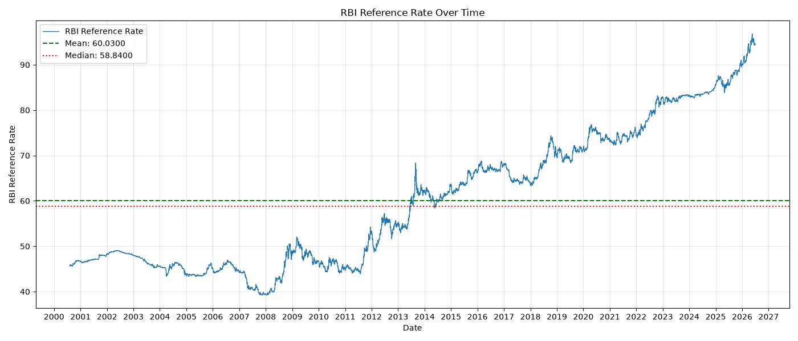

# Project-1-USD-INR-Currency-Exchange-Rate
A Statistical Study of USD/INR Currency Exchange Rate to understand it's behavior.

## Scope of the study
To Understand the USD/INR exchange rate through statistical application.

## Data Source Used
RBI Daily interbank forex rates (USD vis-a-vis INR) Period:(08-08-2000 – 30-06-2026).
https://dbie.rbihub.in/statistics?table=financial_markets.r691_daily_interbank_forex_rates_usd_vis_a_vis_inr

## Methodology
This study uses quantitative descriptive statistical methods to examine historical movements and volatility in
the USD/INR exchange rate. Pandas, Numpy, Matplotlib, Statsmodels, scipy, seaborn python libraries are used
for analysis and visualization.



## Tree Structure of this folder:
```text
├── analysis.ipynb 
├── data
│   └── data.xlsx
├── graphs
│   ├── annual_stats.png
│   ├── hist.png
│   ├── historical_probability.png
│   ├── percentage_change.png
│   ├── rol_volatility.png
│   └── timeseries.png
└── output
    └── analysis.pdf
```
